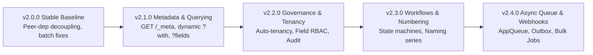

# RFC 0001: Enterprise Architecture Audit & Decoupled Admin Roadmap

- **RFC Number:** 0001
- **Status:** Accepted / Roadmap
- **Author:** Honocube Core Team
- **Created:** 2026-10-28
- **Target Versions:** 2.1.0+ (Progressive Additions)

---

## 1. Executive Summary

Honocube (`@honocube/api`) provides a high-performance, edge-first REST API generator built on top of Hono and Drizzle ORM. It currently supports declarative resource definitions (`defineResource`), Standard Schema validation, basic CRUD endpoints, optimistic concurrency control, and relation synchronization.

To elevate Honocube into an **enterprise-grade application framework** capable of powering large-scale, multi-tenant ERP and CRM systems—while supporting decoupled, framework-agnostic Admin Frontends—this RFC establishes:
1. A comprehensive architectural audit comparing Honocube against **ERPNext / Frappe**, **Payload CMS**, and **Twenty CRM**.
2. A decoupled frontend architecture designed specifically to facilitate **legacy ERP migrations** via the Strangler Fig pattern.
3. A **Regression Testing Matrix** for `@honocube/api` to ensure that future enterprise extensions introduce zero breaking changes to existing deployments.
4. A phased implementation roadmap designed around **Progressive Disclosure of Complexity** (simple for small projects, scalable to enterprise).

---

## 2. Comparative Matrix: Honocube vs. Leading Platforms

| Capability / Domain | Current Honocube | ERPNext (Frappe) | Payload CMS | Twenty CRM | Honocube Target (v2.1+) |
| :--- | :--- | :--- | :--- | :--- | :--- |
| **Schema & UI Reflection** | Code-only (no metadata API) | Native DocType Engine (JSON/DB) | Collection schema JSON for Admin | Standard & Custom Object Metadata API | `GET /api/_meta` Introspection Engine |
| **Multi-Tenancy** | Manual `scope()` filter | Site-based & company-based | Multi-tenant plugin | Workspace / Org isolation engine | Built-in Tenancy Middleware (Row, Schema, DB) |
| **Access Control (RBAC)** | Action string check (`auth.can`) + `authorize` | Role Permissions Manager | Collection & field-level access control | Workspace -> Team -> User hierarchy | Granular RBAC + Team Ownership |
| **Field-Level Security** | Static `hidden: []` only | Read/Write/Hidden per field by role | Dynamic `access.read` / `access.update` | Field-level permissions per role | Dynamic Field-Level Access Control (FLAC) |
| **Document Lifecycle** | Basic CRUD | DocStatus (Draft, Submitted, Cancelled) | Drafts, Versions, Autosave, Publishing | Status stages, pipeline states | State Machine / Workflow Engine |
| **Audit Trail & Revisions** | `timestamps` + in-memory `onEvent` | Detailed Version history, field diffs | Revision history with snapshot rollback | Activity timeline, change feed, audit log | Automated field diffs & revision snapshots |
| **Naming Series / IDs** | DB auto-increment / UUID only | Configurable naming series (e.g. `INV-.YYYY.-.#####`) | Custom ID generators | Human-readable IDs & auto-sequences | Template Naming Series Generator |
| **Dynamic Relations** | Hardcoded static `with` config | Dynamic Link & Child Tables | Dynamic client-driven `?depth=N` & `populate` | Polymorphic relations & GraphQL / REST | Dynamic `?with=...` and `?fields=...` |
| **Background Tasks** | None (Synchronous in HTTP loop) | Background workers (Redis Queue) | Background jobs, worker threads | Worker queue (BullMQ / RabbitMQ) | Pluggable `AppQueue` (Cloudflare / BullMQ) |
| **Bulk Operations** | Synchronous, capped at 100 rows | Asynchronous bulk import/export | Asynchronous bulk operations | Background bulk mutation & CSV mapping | Async Chunked Jobs with Progress Tracking |
| **Event Bus & Webhooks** | In-memory `onEvent` hook | Event streaming, webhooks with retries | Local hooks + custom webhooks | Durable event bus, webhooks, triggers | Transactional Outbox + Webhook Dispatcher |
| **Media / File Storage** | Basic upload to URL path | File manager with folders, attachments | Rich media management, crops, sizes | Storage with attachments & relation links | First-class Media Assets with Presigned URLs |
| **Internationalization** | None | Multi-currency, multi-language UI/DB | Field-level localization (`localized: true`) | Multi-currency, localized formatters | Localized fields & Multi-Currency Engine |

---

## 3. Decoupled Admin Frontend & Legacy Migration Strategy

### The Architectural Problem
Monolithic frameworks like ERPNext tightly bind their frontend (Desk) to the backend (Frappe/Python). When an enterprise wants to modernize away from legacy platforms (SAP, Oracle, custom Java/.NET), they are blocked by an expensive "all-or-nothing" migration.

### The Honocube Solution: Autonomous Admin Configuration
The Admin Frontend will live in a separate package (`@honocube/admin`) with its own independent configuration system.

```
┌─────────────────────────────────────────────────────────────┐
│               Decoupled Admin Dashboard Shell               │
│               (@honocube/admin-core + Theme)                │
└──────────────┬──────────────────────────────┬───────────────┘
               │                              │
     (Honocube Data Provider)       (Legacy Data Provider)
               │                              │
               ▼                              ▼
      Honocube Headless API             Legacy ERP APIs
         (Hono + Drizzle)             (Java / .NET / SAP)
```

1. **The Strangler Fig Migration Pattern:**
   Enterprises can immediately deploy the Honocube Admin UI to replace their aging legacy user interfaces. Initially, certain screens connect to legacy backend APIs via custom data providers, while modern modules connect to Honocube APIs.
2. **Eliminating Duplicate Configuration via Auto-Scaffolding:**
   When using both Honocube backend and frontend, developers avoid double work through the **Metadata Bridge**:
   - The backend exposes `GET /api/_meta`.
   - A CLI generator (`honocube admin:generate`) or dynamic loader (`createAdminResourceFromApi()`) auto-infers default table columns, form inputs, validation rules, and relations.
   - Developers only write frontend config for customizations (e.g., custom tabs, widgets, KPI cards, custom cell badges).
3. **Pluggable Themes & UI Agnosticism:**
   - **Headless Core (`@honocube/admin-core`):** Framework-agnostic state machine managing table pagination, sorting, active filters, form state, dirty checking, and permissions.
   - **Pluggable Themes:** `@honocube/theme-shadcn` (default Tailwind/Radix), `@honocube/theme-dense` (ERPNext-inspired dense data tables), or custom company themes.

---

## 4. Progressive Disclosure of Complexity

Not every project is an enterprise ERP. Honocube must remain lightweight and fast for small SaaS, e-commerce, or simple CRUD backends.

- **Tier 1: Minimal CRUD (Small SaaS / E-Commerce):**
  Only table and validator are required. Zero boilerplate; runs on Cloudflare Workers in under 5ms.
  ```typescript
  export const productsResource = defineResource({
    name: "products",
    table: productsTable,
    validator: productSchema,
    search: { fields: ["name", "sku"] },
    filter: { allow: ["status", "category"] },
  });
  ```
- **Tier 2: Mid-Level Business Applications:**
  Enables soft-delete, file uploads, optimistic concurrency control, and role permissions.
- **Tier 3: Enterprise / ERP / Multi-Tenant Systems:**
  Enables tenancy automation, naming series, state machine workflows, field-level access control, and audit diffs.

---

## 5. Universal Deployment: Cloudflare Edge vs. Node/VPS

To ensure Honocube runs identically on **Cloudflare Workers / D1 / Pages** and **Docker / Node / VPS / Kubernetes**:
1. **Zero Node Built-in Dependencies in Core:** Keep `@honocube/api` strictly dependent on standard Web APIs (`fetch`, `Request`, `Response`, `Headers`, `crypto.subtle`).
2. **Provider Interfaces for Platform Services:**
   - **Database:** `DatabaseAdapter` (supports D1, LibSQL, Neon, Postgres-JS, MySQL2).
   - **Storage:** `AppStorage` (Cloudflare R2 on edge, S3 / MinIO on VPS).
   - **Cache:** `AppCache` (Cloudflare KV on edge, Redis on VPS).
   - **Task Queue:** `AppQueue` (Cloudflare Queues on edge, BullMQ / PgBoss on VPS).

---

## 6. Regression Testing Matrix for `@honocube/api`

Before rolling out enterprise extensions in v2.1+, an automated test suite must lock down existing capabilities to prevent regressions:

### Category A: Core CRUD & Relational Mutations
- [ ] **Single Insert & Reload:** Verify `POST /` returns created record with timestamps.
- [ ] **Atomic Parent-Child Insert:** Verify `POST /` saves parent and children (`many` / `pivots`) in a single batch or transaction.
- [ ] **Parent-Child Update Synchronization:** Verify `PATCH /:id` synchronizes nested relations using `replace`, `append`, and `upsert` strategies.
- [ ] **Batch Operations:** Verify `PATCH /batch-update` and `POST /batch-delete` apply across multiple IDs.
- [ ] **Delete Operations:** Verify permanent hard delete and soft delete (`softDelete` column set to ISO timestamp).

### Category B: Execution Strategies
- [ ] **Batch Strategy (`"batch"`):** Verify statements are accumulated and executed via `tx.batch()` for D1 / LibSQL.
- [ ] **Transaction Strategy (`"transaction"`):** Verify atomic rollback if any child statement fails.
- [ ] **None Strategy (`"none"`):** Verify operations proceed imperatively where transactions are unsupported.

### Category C: Query, Filter & Search Integrity
- [ ] **Pagination Safety:** Verify `limit` and `page` parsing; test boundary conditions (e.g. `limit=0`, negative values, limit exceeding `maxLimit`).
- [ ] **Comparison Operators:** Verify `field__gte`, `field__lte`, `field__gt`, `field__lt`, and `field__like` filters.
- [ ] **Deep Search Subqueries:** Verify search parameter `q` queries across both local columns and related tables via SQL subqueries.
- [ ] **Static Relational Querying:** Verify `with` loads related entities without circular reference failures.

### Category D: Security, Scoping & Validation
- [ ] **Mandatory Scoping:** Verify that rows outside `scope` cannot be listed, retrieved, updated, or deleted even if directly addressed by ID.
- [ ] **Row-Level Authorization:** Verify `authorize()` callback properly blocks unauthorized users with `403 Forbidden`.
- [ ] **Standard Schema Validation:** Verify input schema rejects invalid payloads and formats structured error issues.
- [ ] **Optimistic Concurrency Control:** Verify updates without required version field fail with `400`, and version mismatch fails with `409 Conflict`.

---

## 7. Phased Implementation Roadmap



- **v2.0.0 (Current Release):** Release the peer-dependency decoupling, Standard Schema v1 adoption, and core batch fixes.
- **v2.1.0 (Metadata & Dynamic Queries):**
  - Implement `GET /api/_meta` schema reflection endpoint.
  - Add client-driven `?fields=...` sparse fieldsets and `?with=...` dynamic population.
  - Bootstrap `@honocube/admin-core` prototype.
- **v2.2.0 (Tenancy & Security):**
  - Add built-in Multi-Tenancy middleware (subdomain/header resolution).
  - Add Field-Level Access Control (FLAC) and field masking.
  - Implement automated audit diff logging.
- **v2.3.0 (ERP Core Workflows):**
  - Implement Document Workflow & State Machine engine (`draft` -> `submitted` -> `cancelled`).
  - Implement configurable Naming Series (`{PREFIX}-{YYYY}-{#####}`).
- **v2.4.0 (Async Workers & Integration):**
  - Introduce `AppQueue` interface for background jobs (Cloudflare Queues / BullMQ).
  - Implement asynchronous chunked CSV import/export.
  - Add transactional event outbox and outbound webhook dispatcher with HMAC signatures.
